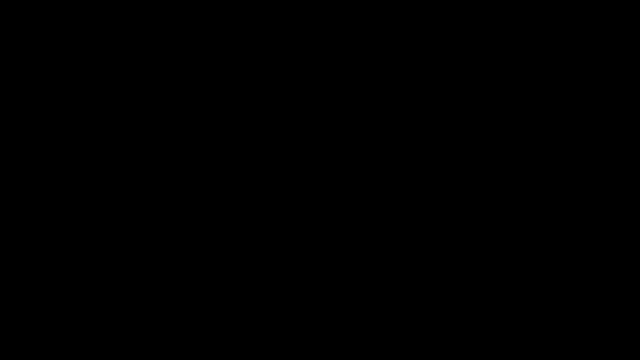

# Lyricscape

**Your lyrics, written across the sky.** Lyricscape turns whatever's playing in the Spotify desktop app into animated lyrics across your whole Mac screen, perfectly in time with the music.

**[Download for macOS](https://github.com/NIKSHITH-G/lyricscape/releases/latest/download/Lyricscape.dmg)** · [Website](https://getlyricscape.vercel.app) · Apple silicon · macOS 14+ · free and open source



▶︎ **Watch the 40-second demo:** [16:9 video](https://getlyricscape.vercel.app/video/lyricscape-demo.mp4) · [vertical 9:16 for Reels / TikTok](https://getlyricscape.vercel.app/video/lyricscape-demo-vertical.mp4)

## Using it

Lyricscape lives in the menu bar (💬). From there or the keyboard:

| Shortcut | Does |
|---|---|
| ⌃⌥⌘L | Show / hide the lyrics |
| ⌃⌥⌘S | Stage mode (solid black background, like a visualizer) |
| ⌃⌥⌘N | Next style |
| ⌘⇧D | Move the lyrics to the next screen (laptop ↔ monitor) |

All of them can be changed in **Settings → General**. The lyrics float above everything, but clicks go straight through them. They also show over full-screen apps and on every desktop.

### Styles

| Style | |
|---|---|
| Constellation | Words become linked neon stars, keywords flare with a shockwave, and stardust builds up over the song |
| Kinetic | Big words slam in with spin, motion blur and screen shake |
| Karaoke | Colour sweeps across each word; lines scroll like a lyrics view |
| Rain | Words fall as they're sung and pile up |
| Orbit | Each line is a rotating ring around a glowing core |
| Typewriter | A terminal typing the lyrics live (try the *Terminal Green* theme) |
| Glitch | RGB split, jitter, slices and scanlines on every hit |
| Particles | Words assemble from particles and burst apart at the end of the line |
| Minimal | One soft line in a corner, for working |

### Settings (menu bar → Settings…, or ⌘,)

- **Live preview** of the chosen style, playing a built-in demo song, so you can try looks without Spotify.
- **Style** picker and **presets**: save the current style and look under a name, and apply it later.
- **Look**:
  - colours: *new every play* (the default, never close to the last few plays), *from album art* (varied on each play), or a *fixed* preset or custom colours
  - font, size, glow, speed, spread / density, opacity, position on screen, neon frame
- **Lyrics & sound**:
  - timing offset (±0.1 s)
  - romanization and/or translation under the lyrics
  - react to the music (beats and bass)
- **General**: show on screen, Stage mode, which display, keyboard shortcuts, launch at login.

## Permissions

| Permission | Why | When |
|---|---|---|
| **Automation → Spotify** | Read the current song and position | Asked on first launch; click OK |
| **Screen & System Audio Recording** | Hear Spotify's audio for beat reactivity (only Spotify's; the screen is never recorded) | Only if you turn on "React to the music" in Settings |

To use **translation**, download the languages once in System Settings › General › Language & Region › Translation Languages, for example Korean, Japanese and Chinese. Romanization needs nothing extra.

Builds are signed ad-hoc (no Apple developer certificate), so macOS may ask for these permissions again after a rebuild. If one gets stuck, reset it with `tccutil reset AppleEvents app.lyricscape.Lyricscape` (or `ScreenCapture`) and relaunch.

## Build & run

No Xcode needed. The Command Line Tools are enough.

```sh
scripts/run.sh                 # build (debug), launch, and stream the app's log here
scripts/test.sh                # unit tests (use this, not plain `swift test`)
scripts/package.sh             # optimized build → build/Lyricscape.dmg and .zip
scripts/make-icon.sh           # regenerate the app icon
```

Developer flags (pass after `--args` with `open`, or run the binary directly):

- `--demo`: the overlay plays the built-in demo song instead of following Spotify.
- `--settings`: open Settings on launch.
- `--snapshot <folder> [--style id] [--times 7,10.6]`: render each style at moments of the demo song to PNGs offscreen (works even with the screen locked) and print each style's per-frame cost.

## Architecture

```
Sources/
  LyricscapeCore/                pure logic, unit tested
    Playback/                    PlaybackClock (interpolation, seek detection), Track
    Lyrics/                      LRCParser (incl. word-timed LRC), WordSplitter (CJK), KeywordPicker
    Sync/                        SyncEngine: playback time → current line / word / progress
    Layout/                      ConstellationLayout, HuePicker, ArtworkPalette, SeededRandom
    Audio/                       BeatDetector (FFT, spectral-flux onsets), AudioLevels
  Lyricscape/                    the app
    App/                         entry point, settings, hotkeys, snapshot tool
    Spotify/                     SpotifyBridge (ScriptingBridge), SpotifyMonitor
    Lyrics/                      LRCLIB client, disk cache, LyricsController, SubtitleService
    Audio/                       AudioReactor (ScreenCaptureKit), AudioController
    Overlay/                     overlay window, LyricsStageView (renderer host), lyric sources
    Styles/                      LyricStyle protocol, StyleKit, ThemeDirector, one file per style
    Settings/                    Settings window and live preview
    MenuBar/                     menu bar panel
```

How the timing works:
1. Spotify's `PlaybackStateChanged` notification reports track changes and play/pause instantly.
2. Polling over Apple Events every 0.5 s gives the exact position.
3. `PlaybackClock` interpolates between readings on a monotonic clock.

Styles are Core Animation layer trees whose properties are set every frame from the playback time. The window server composites them on the GPU, so the app uses only a few percent of the CPU while playing and close to none while paused.
